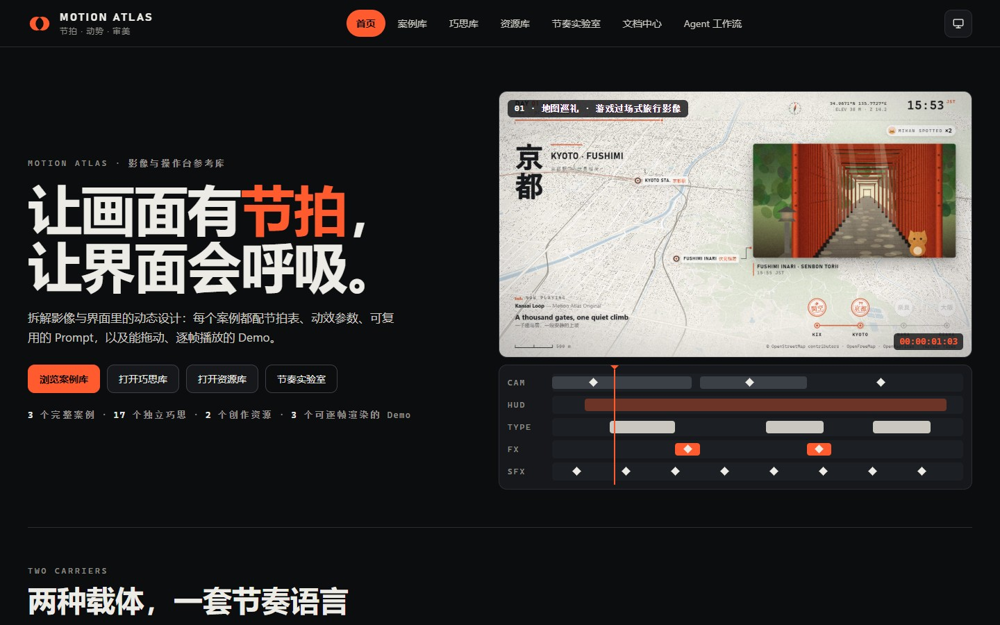
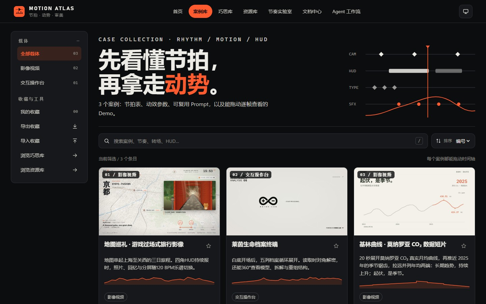
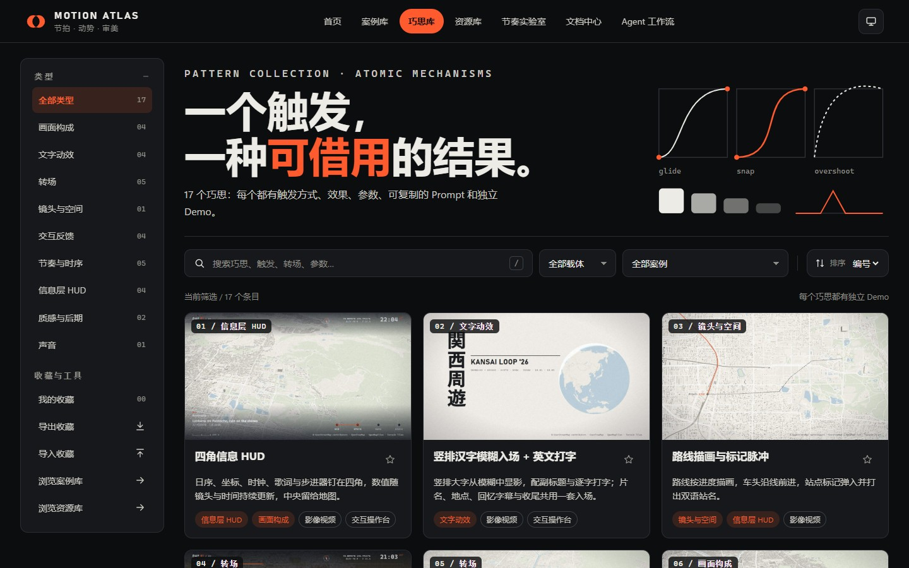
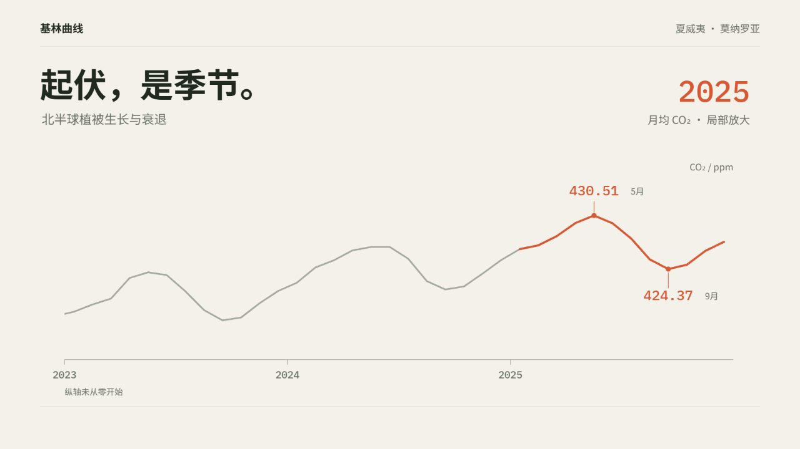
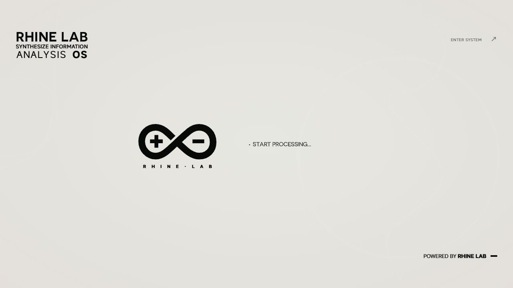

<div align="center">

# MOTION ATLAS

### 可拖动 · 可逐帧 · 可出片的影像与操作台参考库

面向**按时间线播放的影像视频、交互操作台与展示台**的参考库。从完整案例理解镜头、信息层、文字、转场与声音如何协作，从独立巧思借用具体机制；带着节拍表、能量曲线、动效 Token 与可复用 Prompt，在可运行的 Demo 中拖动、跳拍，再逐帧渲染成自己的作品。

<!-- counts:start -->
**6 个案例**　·　**29 个巧思**　·　**2 个资源**　·　**6 个可逐帧渲染的影像 Demo**
<!-- counts:end -->

[打开首页](https://motion-atlas.mibxranime.chatgpt.site/) · [案例库](https://motion-atlas.mibxranime.chatgpt.site/cases.html) · [巧思库](https://motion-atlas.mibxranime.chatgpt.site/patterns.html) · [资源库](https://motion-atlas.mibxranime.chatgpt.site/resources.html) · [节奏实验室](https://motion-atlas.mibxranime.chatgpt.site/lab.html) · [文档中心](https://motion-atlas.mibxranime.chatgpt.site/docs.html) · [Agent 工作流](https://motion-atlas.mibxranime.chatgpt.site/agent.html)


<sub>配图来自可运行 Demo 的实际浏览器截图。</sub>

</div>

## 收录边界

本库收录以时间线为载体的作品：作品掌握节奏，按时间线播放；即使可以交互，也是在时间线上分支。每个时间驱动的 Demo 都能逐帧渲染成视频。

**收录**
- 影像视频：片头、宣传片、旅行影像、数据短片等
- 交互操作台与展示台：带自动驾驶时间轴的终端、档案界面、展会展示
- 能从案例中单独借用的转场、节奏、文字动效、画面构成、信息层、质感、声音与镜头巧思

**不收录**
- 网站与网页应用，包括其中的页面动效和微交互。这类设计收录在 Web Atlas。

**判定**
1. 最终形态是视频，或是带时间轴、按时间线播放的操作台／展示台：收录，即使它运行在浏览器里。
2. 最终形态是网站或网页应用：不收录。
3. 仍难判断时，设想把它逐帧导出为视频。核心价值仍在，收录；价值依赖重排、滚动阅读和观看者自己的节奏，不收录。
4. 同一来源在两种载体上都有价值时，只收录时间线部分，条目本身保持完整。
5. 主题相同、表现形式不同的作品可以分别出现在两个库里，各自是独立条目，互不引用。
6. 画幅不是判据：原作即使是固定画幅，复刻时也可以调整或拓展。各判据冲突时，以“谁掌握时间”为准。例如一个固定画幅、但完全由观看者拖拽操作、没有时间线的网页光照演示，不属于本库。

## 在这里能做什么

每个案例保留设计重点、节奏结构、画面分层、动效参数、适用边界、Prompt 与迁移指引。先在 Demo 中看清动作，再把内容和参数带回自己的作品。

- **查找与筛选**：搜索名称、标签、机制与用途，按载体找案例；巧思可按类型、载体与所属案例筛选，资源可按类型筛选，也可只看收藏或按名称排序。
- **内嵌体验**：详情上方直接运行 Demo，首屏刻度条与节拍点对应画面时刻；加载进度、播放、暂停和全屏控件集中在舞台周围。
- **拖动与跳拍**：拖动刻度条定位，点击节拍时间或跳到上／下一个标记，反复查看同一个动作的进入、停留与退出。
- **横竖构图**：地图巡礼与档案终端支持横竖两套构图，切换时保持当前时刻、整体等比缩放；基林曲线保留横屏。切换按钮只对支持多画幅的 Demo 显示。
- **声音开关**：声音默认关闭，主动开启后与画面同步；可随时静音。不同 Demo 使用合成乐谱、即时反馈音或已混好的音轨，具体来源见条目说明。
- **巧思库**：每项说明机制、触发、结果、参数、减少动态策略与独立 Demo；通过骨架、支撑、点睛职责及搭配／冲突关系判断怎样组合，并回到来源案例查看整体。
- **资源库**：阅读制作视频的 skill 与工具工作流、适用与避用、作者效果图、安装方式、固定版本原文与许可。
- **节奏实验室**：用多音色节拍器、拍号、细分与摇摆练习节拍；通过 A/B 对比、打拍录入、首拍偏移与量化强度理解吸附，让曲线、时长和错峰对齐拍子，导出 CSS 变量、MotionKit 乐谱代码、Prompt 与 WAV。
- **复制 Prompt**：案例提供实现指令、视频生成指令与负向约束，巧思提供实现 Prompt；结合具体参数与制作约束替换自己的内容。
- **收藏与备份**：案例、巧思与资源共用一份 JSON 备份，支持导出与合并导入；收藏留在当前浏览器，不跨设备自动同步。
- **文档中心**：集中阅读使用指南、节奏方法、Prompt 写法、条目结构、渲染管线与全部案例／巧思 Prompt。
- **Agent 取材**：从结构化索引找到资料包，连同条目、Prompt、入口与文件清单读取；[配套 skill](https://github.com/MIBXR/mibxr-skills/tree/main/skills/motion-atlas) 提供另一种使用入口。
- **逐帧出片**：按帧率定位并截图，导出可用音轨；本机有 ffmpeg 时可自动合成 MP4，同一个 Demo 可用于实时体验与视频输出。

## 网站本体

首页介绍案例、巧思、资源与节奏方法；案例库理解完整作品，巧思库拆看单个机制，资源库查制作工作流。主导航直接连接各库、节奏实验室、文档中心与 Agent 工作流。

| 首页 | 案例库 |
| --- | --- |
|  |  |
| 巧思库 | 资源库 |
|  |  |

以上为网站本体的实际浏览器首屏截图；各案例的独立 Demo 预览见下方画廊。

## 按类型理解巧思

| 类型 | 数量 | 关注点与例子 |
| --- | ---: | --- |
| 转场 | 5 | 画面或状态怎样衔接：卡片展开为全屏、昼夜逐层插值 |
| 节奏与时序 | 5 | 动作发生与停留的时间关系：可逐帧定位时间轴、空闲呼吸 |
| 交互反馈 | 4 | 操作与状态变化的回应：滚动数字、阵列选择波浪 |
| 文字动效 | 4 | 文字的进入与变化：竖排模糊标题、终端逐字开机 |
| 画面构成 | 4 | 区域、层级与对比关系：四角 HUD、章节框线、分屏对比盖章 |
| 信息层 HUD | 4 | 随时间更新的叠加信息：路线描画、收集计数 |
| 质感与后期 | 2 | 材质与清晰度变化：胶片颗粒、磨砂转清 |
| 声音 | 1 | 与动作同步的听觉提示：终端逐字开机的打字音 |
| 镜头与空间 | 1 | 路线与视点的空间关系：路线描画与标记脉冲 |

数量按 [巧思条目](entries/patterns/) 的类型标签统计，一个巧思可以有多个类型。地图巡礼的 12 个巧思使用固定舞台与乐谱。

## Agent 直接取材

网页用于亲手预览；Agent 从 [工作流入口](https://motion-atlas.mibxranime.chatgpt.site/agent.html)、[结构化索引](agent/catalog.json) 与按条目生成的资料包取得完整上下文。索引包含摘要、标签、关联、协议、计数与资料包路径，使用方法见 [AGENT.md](AGENT.md)。工作流页的指令生成器可选择条目，生成交给编码 Agent 或视频模型的任务说明。

| 资料 | 路径 | 资料包包含什么 |
| --- | --- | --- |
| 案例 | `agent/cases/<id>.json` | 完整 `entry`、`documents.prompt`、`entrypoint` 与 `files[]` |
| 巧思 | `agent/patterns/<id>.json` | 完整 `pattern`、来源案例包 `sourceCases`、Prompt、入口与文件清单 |
| 资源 | `agent/resources/<id>.json` | 完整 `resource`、原文 `documents`、skill 入口与文件清单 |

`files[]` 列出路径与字节数，源码和媒体按清单读取；案例与巧思的可运行入口随包给出。组合时先看 `composition.role` 的骨架、支撑、点睛，再读 `pairsWellWith` 与 `conflicts`。

```bash
node scripts/atlas.mjs search "转场 地图" --limit 5
node scripts/atlas.mjs show map-pilgrimage --source
node scripts/atlas.mjs export split-compare-stamp --out ../my-demo
```

命令只需 Node.js，无需安装依赖；导出包含可运行 Demo、`PROMPT.md`、`README.md` 与 `entry.json`。资源从独立目录读取；配套 [motion-atlas skill](https://github.com/MIBXR/mibxr-skills/tree/main/skills/motion-atlas) 与本仓库的资料格式一同使用。

## 资源库取材

[资源库](https://motion-atlas.mibxranime.chatgpt.site/resources.html) 收录用于制作视频、但没有完整可复刻作品源码的 skill 与工具。条目包含归库理由、工作流、适用与避用、关联案例、上游版本、安装方式、盘点证据及许可；有对应案例时通过 `relatedEntries` 关联。

| 资源 | 制作方向 | 原文快照与条目 |
| --- | --- | --- |
| motion-showreel | 用 `render(t)` 逐帧渲染短视频 | [Skill 原文](agent-skills/motion-showreel/SKILL.md) · [条目](entries/resources/motion-showreel.json) |
| web-video-presentation | 制作按步推进、用于录屏的网页演示 | [Skill 原文](agent-skills/web-video-presentation/SKILL.md) · [条目](entries/resources/web-video-presentation.json) |

Agent 先读 [资源目录](agent/resources.json)，再打开 `agent/resources/<id>.json` 的 `resource`、`documents` 与 `files[]`。`agent/catalog.json` 也登记 `resourceCatalog` 和 `counts.resources`。Agent Skill 资源的原文按固定提交保存在 `agent-skills/<id>/`，保留原语言、原字节、附属文件与上游许可。

资源效果图标注**“作者产出，未复刻”**，逐图保留原 URL 与许可说明；静帧不作为动态效果的验证。安装、使用或复用图片前，分别核对工作流边界与图片许可。

## 案例画廊

图片进入对应在线条目，可继续打开 Demo、Prompt 与原始 JSON。以下直接使用仓库已有预览图；作品的来源、适用范围与复现边界以各条目为准。

### 影像视频 · 2

时间线控制镜头、信息与声音，从完整旅程或同一组数据建立节奏。

<table>
<tr>
<td width="50%" valign="top"><a href="https://motion-atlas.mibxranime.chatgpt.site/cases.html#case/map-pilgrimage"></a><br><strong>地图巡礼 · 游戏过场式旅行影像</strong><br><sub>60 秒从上海飞抵关西，串起京都、奈良与大阪；横竖两套构图配合成乐谱。</sub><br><br><a href="https://motion-atlas.mibxranime.chatgpt.site/demos/cases/map-pilgrimage/index.html">Demo</a> · <a href="prompts/cases/map-pilgrimage.md">Prompt</a> · <a href="entries/cases/map-pilgrimage.json">条目</a></td>
<td width="50%" valign="top"><a href="https://motion-atlas.mibxranime.chatgpt.site/cases.html#case/keeling-curve"></a><br><strong>基林曲线 · 莫纳罗亚 CO₂ 数据短片</strong><br><sub>20 秒沿同一条 NOAA 真实月均曲线推近季节锯齿、拉远长期趋势，横屏展示。</sub><br><br><a href="https://motion-atlas.mibxranime.chatgpt.site/demos/cases/keeling-curve/index.html">Demo</a> · <a href="prompts/cases/keeling-curve.md">Prompt</a> · <a href="entries/cases/keeling-curve.json">条目</a></td>
</tr>
</table>

### 交互操作台 · 1

手动操作与自动驾驶时间轴并存，外部定位回到预设演示流程。

<table>
<tr>
<td valign="top"><a href="https://motion-atlas.mibxranime.chatgpt.site/cases.html#case/archive-os"></a><br><strong>莱茵生命档案终端</strong><br><sub>77.6 秒演示开机、档案阵列、读取、3D 模型与四向翻阅；支持横竖构图与手动操作。</sub><br><br><a href="https://motion-atlas.mibxranime.chatgpt.site/demos/cases/archive-os/index.html">Demo</a> · <a href="prompts/cases/archive-os.md">Prompt</a> · <a href="entries/cases/archive-os.json">条目</a></td>
</tr>
</table>

## 节奏与动效怎样统一表达

| 内容 | 条目中的表达 | 在作品中的作用 |
| --- | --- | --- |
| 节拍表 | `rhythm.duration / bpm / beats[]`，每拍记录 `t / label / note` | 把发生时刻、动作与阅读停留对齐，点击时间即可定位 |
| 能量曲线 | `energy` 为 0–1 等距采样；`energySegments` 记录实际秒数分段，`energyNote` 说明来源 | 描述作品的起伏与松紧；数值可以是分析估计，不等同于音频测量 |
| 动效 Token | `tokens.palette / type / motion`，巧思另列 `timing` | 统一配色、字体、曲线、时长、错峰与运动幅度 |
| 镜头轨 | `layers` 中的镜头层，结合构成与动效参数 | 组织视点、推拉、跟随与空间连续性 |
| 信息层轨 | `layers` 中的数据、读数、HUD 等层 | 保持坐标、路线、状态和度量口径清晰 |
| 文字轨 | `layers` 中的标题、字幕与标签层 | 安排文字入场、强调和可读的停留时间 |
| 转场轨 | `layers` 中的转场与特效层 | 连接画面或状态，控制遮罩、清晰度与局部强调 |
| 声音分轨 | `layers` 与 `composition.sound`，结合乐谱或混音音轨 | 对齐音乐、音效与画面事件，保留主动开关和来源说明 |

`layers` 按作品实际需要命名，并非每项都强制同一组轨道。能量分段与等距采样同时存在时优先显示分段曲线。完整字段见 [条目结构](docs/methodology.md)，节拍、曲线与吸附方法见 [节奏方法](docs/rhythm.md)。

## 复用与体验

### 本地运行

需要 **Node.js 22+**；截图、渲染与取帧还需本机 Edge 或 Chrome，无需安装项目依赖。

```bash
node scripts/serve.mjs --port 4321
```

打开 [http://localhost:4321/](http://localhost:4321/)，按 `Ctrl+C` 结束服务。地图 Demo 的 MapLibre、底图与高程瓦片需要网络，具体地址和回退方式见其配置与 [渲染管线](docs/pipeline.md)。

### 逐帧渲染与出片

时间驱动的 Demo 暴露 `window.__motion`，脚本等待资源就绪，再按帧率逐帧定位并截图：

```bash
# PATH 上有 ffmpeg 时自动合成 MP4
node scripts/render.mjs demos/cases/map-pilgrimage/index.html --fps 30
# 竖屏成片，同时导出该 Demo 的音轨
node scripts/render.mjs demos/cases/archive-os/index.html --orient portrait --fps 30 --audio
```

`--from / --to` 限定片段，`--audio-only` 只导出可用音轨；没有 ffmpeg 时保留帧序列与 WAV，并打印合成命令。画幅、音轨、输出格式与性能说明见 [渲染管线](docs/pipeline.md)。

### 从参考到自己的作品

1. 打开完整案例与相关巧思，查看动作、节拍、参数和适用边界，再用上面的 CLI 导出需要的 Demo。
2. 复制 Prompt，替换内容、配色、素材与尺寸，同时保留需要的约束和负向指令。
3. 地图巡礼从 `config.js` 调整旅程、时间表与声音，路线几何另见 `paths.js`；巧思按各自实现调整 `config.js` 或 `index.html` 顶部的 `CONFIG`。
4. 档案终端的 `config.js` 设置时间参数，内容改动按条目的 `migration` 阅读上游源码；基林曲线按同一字段定位 `timeline.js`、`scene.js`、数据与音频说明文件。
5. 在实际页面中检查目标画幅、拖动、节拍、声音与减少动态效果，再渲染所需片段。

迁移入口以每个条目的 `migration` 为准；保留时间结构与动效参数时，也需重新核对新内容的阅读时长、素材授权与声画落点。

### 收藏与迁移

案例、巧思与资源收藏保存在当前站点浏览器的 `localStorage`，共用 `ma-favorites`。各库可导出 `motion-atlas-favorites.json`，导入时合并有效条目、去重并忽略未知 ID。

收藏不上传，也不会自动写入 Git；更换浏览器、域名、端口或清理网站数据后不会自动恢复。迁移前导出同一份 JSON，在新地址导入即可继续使用。

### 文档中心

[文档中心](https://motion-atlas.mibxranime.chatgpt.site/docs.html) 集中阅读 [使用指南](docs/guide.md)、[节奏方法](docs/rhythm.md)、[Prompt 写法](docs/prompting.md)、[条目结构](docs/methodology.md)、[渲染管线](docs/pipeline.md) 与案例／巧思 Prompt。指南维护在 `docs/`，Prompt 由条目生成，运行构建同步文档目录。

## 资料结构与维护

```text
entries/                      案例、巧思与资源条目（唯一内容源）
agent-skills/                 资源库的上游 skill 原样快照与许可
demos/                        可运行 Demo；按时间播放的 Demo 遵守 render(t) 协议
kit/motion-kit.js             共享运行时：固定画幅、时间轴、缓动、节拍、合成乐谱、预加载、控制条
docs/                         指南与使用方法
docs/readme/                  README 封面
docs/site/                    网站本体的实际浏览器截图
prompts/ agent/ data/         由 entries 生成（勿手改）
previews/                     Demo 实际截图，含案例桌面与手机预览
assets/resources/             资源库作者效果图（未复刻）
scripts/                      本地播放、构建、检查、截图、视频导出与命令行工具
```

| 命令 | 作用 |
| --- | --- |
| `node scripts/build.mjs` | 同步 kit 副本，生成站点数据、Prompt 文档、Agent 资料包与本文件的计数 |
| `npm run build:site` | 使用 `--site` 生成发布站点到 `dist/`；≥128 KiB 的媒体从固定 Git 提交的 GitHub 地址加载 |
| `npm run build:local` | 生成包含全部素材的 `dist/`，供完整本地分发 |
| `node scripts/capture.mjs` | 重新截取预览图（需先启动本地服务器） |
| `node scripts/frames.mjs <video>` | 参考视频取帧，生成带时间码的接触表 |

新增条目遵循 [贡献流程](CONTRIBUTING.md)，Agent 使用与维护规则见 [AGENT.md](AGENT.md)。共享运行时只改 `kit/motion-kit.js`，Demo 中的副本由构建同步。

发布前先运行 `npm run build`，以已提交并推送的源码运行 `npm run build:site`（等同于 `node scripts/build-static.mjs --site`）。站点配置见 [.openai/hosting.json](.openai/hosting.json)。发布包中的 `assets/asset-sources.js` 记录源码提交与大素材地址；新增大图、音视频、字体与模型自动纳入，JS、CSS 和小素材随站点部署。源码与完整本地包保留原始素材。

发布模式的 `MotionAtlasAssets.resolve(url)` 解析素材地址，兼容图片、字体与 `fetch` 加载；MotionKit 负责预加载、缓存、进度与就绪通知。外部地图瓦片及未列入清单的请求沿用原地址，发布模式需要联网访问 GitHub 素材。

## 版权与研究边界

本库用于设计与制作研究，案例的来源、观察范围、近似实现、限制与迁移条件以条目为准。参考一种节奏或机制不等于取得原作素材的使用许可，也不将局部实现称为完整原作复刻。

新增案例与巧思按 [AGENT.md](AGENT.md) 和 [贡献指南](CONTRIBUTING.md) 的收录规范，不提交第三方画面、角色、标志、音乐、字体文件和参考视频取帧。参考视频的 `frames/`、`renders/` 仅供本地分析；资源库原文与作者效果图另按固定来源、逐项许可和“作者产出，未复刻”规则管理。

用户自制或公开许可素材须保留各自来源与署名。基林曲线的 NOAA 数据归属及口径见 [DATA.md](demos/cases/keeling-curve/DATA.md) 与原始数据文件头；CC BY 4.0 音乐、CC0 音效的完整署名与许可见 [AUDIO.md](demos/cases/keeling-curve/AUDIO.md)、`audio/` 和片尾；OFL 字体许可保存在该 Demo 的 `fonts/` 中。

档案终端移植自 RhineLabUI，相关名称、标志、设定、原片短音与第三方内容按 [许可、署名与免责声明](demos/cases/archive-os/LICENSES.md) 分别处理。上游代码的 MIT 许可不替代第三方权利人的授权；复用前仍需核对目标用途与各项素材许可。
