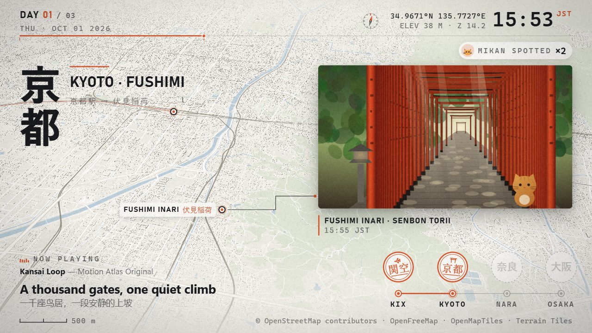

# Motion Atlas · 多媒体动态视觉参考库

面向**影像视频、交互操作台、交互展示台**的动态设计参考库。每个案例都拆成镜头、信息层、文字、转场与声音轨道，附节拍表、能量曲线、动效 Token、可复用 Prompt，以及可以拖动、跳拍、逐帧渲染成视频的零依赖 Demo。

**在线浏览：[Motion Atlas](https://motion-atlas.mibxranime.chatgpt.site)**

<!-- counts:start -->
**3 个案例**　·　**22 个巧思**　·　**3 个可逐帧渲染的影像 Demo**　·　**59 种代码片风格**　·　**703 条视频提示词**　·　**7 个 Skill**
<!-- counts:end -->



姊妹项目：[Design Atlas](https://github.com/MIBXR/design-atlas)（网页前端设计参考库）。Design Atlas 关心页面的版式与组件；Motion Atlas 关心画面在时间里怎么走：节拍、动势、转场、反馈与收尾。

## 收录内容

### 案例

| 案例 | 载体 | 证据 | 时长 |
| --- | --- | --- | --- |
| [地图巡礼 · 游戏过场式旅行影像](demos/cases/map-pilgrimage/) | 影像视频 / 交互展示台 | 逐帧/源码实测 | 60s |
| [莱茵生命档案终端](demos/cases/archive-os/) | 交互操作台 / 交互展示台 | 逐帧/源码实测 | 77.6s |
| [终末地 · 集成工业协议](demos/cases/industrial-protocol/) | 影像视频 / 交互展示台 | 本地转译 | 60s |

三个案例都来自用户提供的参考或真实存在的界面：地图巡礼转译自用户提供的参考；莱茵生命档案终端是 [RhineLabUI](https://github.com/LBEILC/RhineLabUI)（MIT）的忠实移植，沿用其代码、模型、字体、音频与档案内容；终末地工业协议照《明日方舟：终末地》集成工业系统（AIC）的真实界面与交互重做，美术为生成的平面风格素材，不含官方图像。

地图巡礼与工业协议采用横屏 1920×1080 / 竖屏 1080×1920 两套固定画幅构图，档案终端为横屏 1920×1080；三者都整体等比缩放，可离线逐帧导出视频。地图巡礼从上海飞抵关西机场，走访京都伏见稻荷、鸭川、奈良公园与大阪道顿堀，地图瓦片按镜头计划渐进下载，缓冲不足时暂停等待。档案终端以上游界面配合虚拟时钟重放开机、档案浏览与解密。工业协议用 60 秒走完标题、AIC 探索界面、放置蓝图、配件机面板、干员升级、分享蓝图与收尾七个场景。

地图巡礼的 12 个巧思使用固定舞台、预加载与乐谱；档案终端与工业协议各自的 5 个巧思仍是自适应布局与原有音效调用，将在后续迭代迁移。

### 巧思

从案例里拆出来的单个技巧，每条都有触发、结果、参数、组合关系（骨架 / 支撑 / 点睛）、减少动态策略与独立 Demo：

| 类型 | 数量 | 例子 |
| --- | --- | --- |
| 转场 | 6 | 卡片展开为全屏、昼夜逐层插值 |
| 节奏与时序 | 6 | 可 seek 时间轴、空闲呼吸 |
| 交互反馈 | 5 | 长按确认 |
| 文字动效 | 5 | 竖排模糊标题、字符解码、滚动数字 |
| 画面构成 | 5 | 四角 HUD、章节框线、分屏对比盖章、切角面板 |
| 信息层 HUD | 5 | 路线描绘、收集计数 |
| 质感与后期 | 2 | 胶片颗粒、解码扫描 |
| 声音 / 镜头 | 1 / 1 | 打字音；路线跟随镜头 |

### 外部资源

[资源库](resources.html) 原样收录外部仓库的视频提示词与 Skill，保存在 `resources/`，保留上游许可与署名，详见 [docs/resources.md](docs/resources.md)。

| 资源 | 内容 | 上游 | 许可 |
| --- | --- | --- | --- |
| 视频提示词 | 703 条 Claude Opus 5.5 视频的提示词，附原帖与复刻链接 | [yihui-dev/awesome-opus5-5-videos](https://github.com/yihui-dev/awesome-opus5-5-videos) | 列表 MIT；视频与提示词归各作者 |
| 代码片风格 | 59 种风格的规范、样片说明与样片源码；24 个样片可在站内逐帧播放 | [lemomo-ai/lemo-opuscar](https://github.com/lemomo-ai/lemo-opuscar) | 代码与文档 MIT；成片与静帧 CC BY 4.0（LemoLab） |
| Skills | 6 个 Skill，含 motion-showreel、web-video-presentation | [ConardLi/garden-skills](https://github.com/ConardLi/garden-skills) | MIT |
| Skills | ai-handdrawn-video：AI 手书 / PV 制作流程 | [waterpro/agent-anime-skill](https://github.com/waterpro/agent-anime-skill) | 未声明许可；上游注明仅供个人娱乐、请勿商业用途 |

## 快速开始

需要 Node.js 22+ 与本机的 Edge 或 Chrome（截图、渲染、取帧脚本用），无需安装依赖。

```bash
node scripts/serve.mjs --port 4321
```

打开 <http://localhost:4321/>：

- **案例库 / 巧思库**：筛选、收藏（可导出 JSON 备份）、内嵌 Demo、首屏刻度条与节拍点、加载进度、声音开关、全屏与三段 Prompt；支持固定画幅的 Demo 可切换横竖构图并保持当前时刻。
- **节奏实验室**：用多音色节拍器、拍号 / 细分 / 摇摆练节拍，以 A/B 对比、打拍录入、首拍偏移与量化强度理解吸附；曲线、时长和错峰可对齐拍子，导出 CSS 变量、MotionKit 乐谱代码、Prompt 与 WAV。
- **文档中心**：指南、节奏方法、Prompt 写法、渲染管线、收录方法、3 篇研究笔记与全部 Prompt。
- **Agent 工作流**：资料格式、CLI 与指令生成器。

## 复用

```bash
# 检索、查看、导出
node scripts/atlas.mjs search "转场 地图" --limit 5
node scripts/atlas.mjs show map-pilgrimage --source
node scripts/atlas.mjs export split-compare-stamp --out ../my-demo

# 逐帧渲染（PATH 上有 ffmpeg 时自动合成 MP4）
node scripts/render.mjs demos/cases/map-pilgrimage/index.html --fps 30
# 固定画幅案例：竖屏成片，同时导出同一乐谱的音轨
node scripts/render.mjs demos/cases/archive-os/index.html --orient portrait --fps 30 --audio
```

每个案例 Demo 的内容都集中在 `config.js`，巧思 Demo 集中在 `index.html` 顶部的 `CONFIG` 块：改文案、配色、时刻表即可迁移，时间结构与动效参数保持不变。

## 目录

```text
entries/            案例与巧思条目（唯一内容源）
demos/              可运行 Demo；时间驱动的 Demo 遵守 render(t) 协议
kit/motion-kit.js   共享运行时：固定画幅、时间轴、缓动、节拍、合成乐谱、预加载、控制条
docs/               指南、方法与研究笔记
prompts/ agent/ data/   由 entries 生成（勿手改）
previews/           Demo 实际截图
scripts/            serve / build / check / smoke / capture / shot / render / frames / atlas
```

## 维护命令

| 命令 | 作用 |
| --- | --- |
| `node scripts/build.mjs` | 校验条目、同步 kit 副本，生成站点数据、Prompt 文档、Agent 资料包与本文件的计数 |
| `npm run build:site` | 生成完整静态站点到 `dist/`，用于 Sites 发布；站点配置见 `.openai/hosting.json` |
| `node scripts/check.mjs` | 只读检查：条目与引用、kit 副本、生成物是否最新、预览图；舞台字号按设计决定，不设下限；网站界面 ≥ 12px。 |
| `node scripts/smoke.mjs [--strict-fonts]` | 无头浏览器逐个 Demo 检查全时间轴与播放；固定舞台另测两画幅、切换保持时刻及运行时字号，`--strict-fonts` 将字号警告计为失败 |
| `node scripts/capture.mjs` | 重新截取预览图（需先启动本地服务器） |
| `node scripts/frames.mjs <video>` | 参考视频取帧，生成带时间码的接触表 |

新增条目的流程见 [CONTRIBUTING.md](CONTRIBUTING.md)，给 Agent 的说明见 [AGENT.md](AGENT.md)。

## 证据与版权

- 每条资料标注证据等级：逐帧/源码实测、本地转译、公开资料推断·待核验、原创设计。终末地式游戏界面案例目前为“推断”，核验方法见 [docs/methodology.md](docs/methodology.md)。
- 仓库不包含任何第三方的画面、角色、标志、音乐或字体文件。Demo 中的人物、地点与插画为程序绘制的原创内容，游戏专有名词已替换为原创名称。品牌与作品权利归各自所有者。
- 地图 Demo 使用 [OpenFreeMap](https://openfreemap.org/) 矢量瓦片与 [MapLibre GL JS](https://maplibre.org/)，地图数据 © OpenStreetMap 贡献者。
- 参考来源与链接列在 [docs/methodology.md](docs/methodology.md#七来源) 与各篇研究笔记中。
