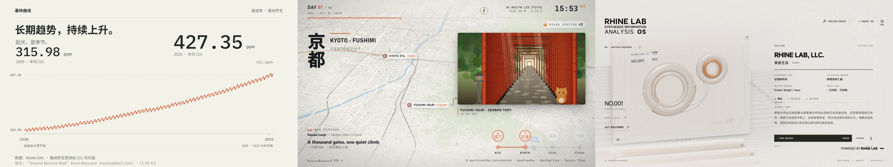
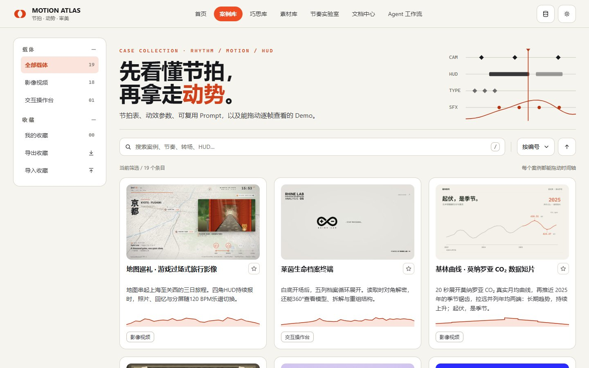
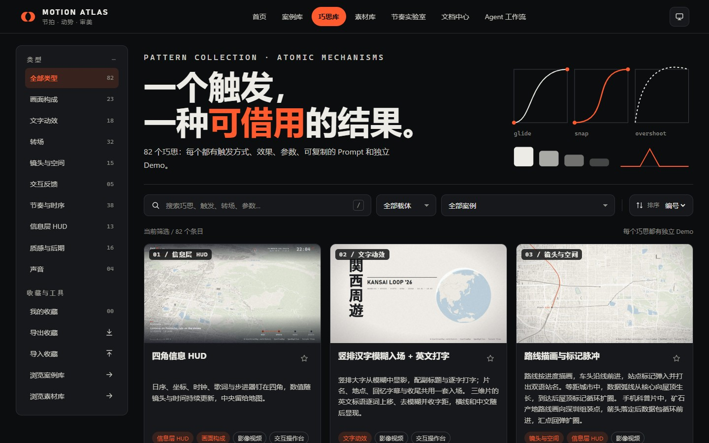
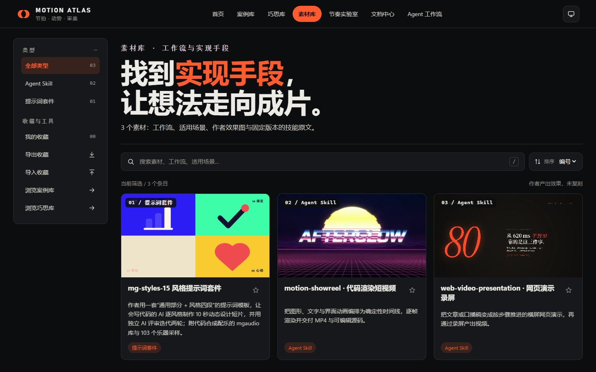

# MOTION ATLAS

### 可拖动 · 可逐帧 · 可出片的影像与操作台参考库

面向**按时间线播放的影像视频、交互操作台与展示台**的参考库。从完整案例理解镜头、信息层、文字、转场与声音如何协作，从独立巧思借用具体机制；带着节拍表、能量曲线、动效 Token 与可复用 Prompt，在可运行的 Demo 中拖动、跳拍，再逐帧渲染成自己的作品。

<!-- counts:start -->
**18 个案例**　·　**82 个巧思**　·　**2 个素材**　·　**18 个可逐帧渲染的影像 Demo**
<!-- counts:end -->

[首页](https://motion-atlas.mibxranime.chatgpt.site/) · [案例库](https://motion-atlas.mibxranime.chatgpt.site/cases.html) · [巧思库](https://motion-atlas.mibxranime.chatgpt.site/patterns.html) · [素材库](https://motion-atlas.mibxranime.chatgpt.site/materials.html) · [节奏实验室](https://motion-atlas.mibxranime.chatgpt.site/lab.html) · [Agent 工作流](https://motion-atlas.mibxranime.chatgpt.site/agent.html) · [文档中心](https://motion-atlas.mibxranime.chatgpt.site/docs.html)

案例提供完整作品，巧思拆解可借用的机制，素材提供制作资源。节奏实验室用节拍器、A/B 吸附、曲线和错峰演示节奏，可导出 CSS、MotionKit 乐谱、Prompt 与 WAV。

| 首页 | 案例库 |
| --- | --- |
|  |  |
| 巧思库 | 素材库 |
|  |  |

使用方式见[使用指南](docs/guide.md)，节拍与动效见[节奏方法](docs/rhythm.md)，代码出片见[渲染管线](docs/pipeline.md)。Agent 从[取材说明](docs/agent.md)和[结构化目录](agent/catalog.json)进入；也可使用[配套 skill](https://github.com/MIBXR/mibxr-skills/tree/main/skills/motion-atlas)。

本地启动、收录规则与新增流程见[贡献指南](CONTRIBUTING.md)，修改仓库见[维护约束](AGENTS.md)。
